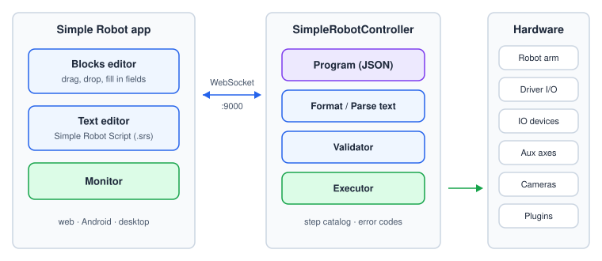
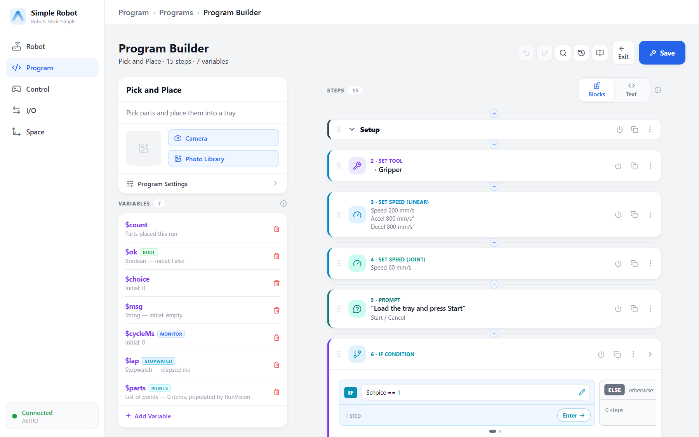
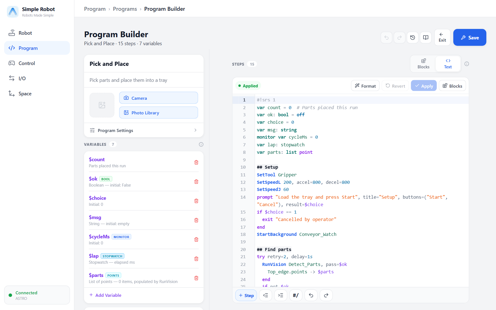
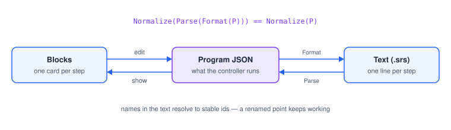

# Introduction

This manual describes how to program a SimpleRobot: the concepts behind a program, every
instruction (step) you can use, the functions and properties available in expressions, and the
error codes a program can raise. It covers both ways of writing a program — the **Blocks** editor
and **Simple Robot Script**, its text form — because they are two views of the same thing.

## How this manual is organised

| Part | What it contains |
|---|---|
| **Part I — Concepts** (chapters 1–15) | How programs are built and run: structure, data, expressions, points and frames, motion, I/O, flow control, routines, error handling, debugging, background programs, vision, operator prompts and plugins. Read these in order the first time. |
| **Part II — Reference** (chapters 16–18) | One entry per instruction, in the same layout every time; the functions and properties you can use in expressions; every error and problem code. Use these to look things up. |
| **Appendices** | The text grammar, the keyword list and quick-reference cards. |

The instruction reference, the function list and the error-code tables are generated from the
controller's own step catalog, so they always match the controller the manual was built for.

## The system at a glance



- **SimpleRobotController** runs on the computer attached to the robot. It stores programs, checks
  them, and runs them. It is the single source of truth: every app connected to it sees the same
  programs and the same live state.
- **The Simple Robot app** (web, Android and desktop) connects to the controller over the network.
  You write programs in it, run them, and watch them on the monitor.
- **The hardware** — the arm, the driver board's inputs and outputs, IO devices (such as Arduino
  Nano boards), auxiliary stepper axes (grippers, conveyors, rotary tables), cameras — and plugins
  are all reached through the controller.

## Blocks and text

Every program can be edited as **Blocks** (a card per step, filled in with forms) or as **Text**
(one line per step). Switch between them at any time with the **Blocks | Text** control at the top
of the step list; nothing is lost in either direction.





The text language uses the same names as the blocks (`MoveL`, `SetOutput`, `RunVision` …), so what
you learn in one carries over to the other. Flow control and assignment use familiar lowercase words
(`if`, `repeat`, `$x = …`).



## A first program

```srs
#!srs 1
var count = 0              # Parts placed this run

## Setup
SetTool Gripper
SetSpeedL 200, accel=800, decel=800

## Pick and place
repeat 12 as $i
  JumpL stack Bins[$i], z=60
  GripperAction close
  JumpL grid Tray[$i], z=60
  GripperAction open
  $count = $count + 1
end
status "Placed {$count} parts"
```

Reading it from the top:

1. `var count = 0` declares a number variable. The comment after it becomes its description.
2. `## Setup` is a section header — it is not executed, it organises the program.
3. `SetTool Gripper` makes the gripper's tool frame active, so points are reached with the
   gripper tip. `SetSpeedL` sets the default linear speed for the moves that follow.
4. `repeat 12 as $i … end` runs its body twelve times with `$i` counting 0 to 11.
5. `JumpL` lifts, travels and lowers — here to a slot of the stack `Bins` and to a cell of the grid
   `Tray`. `GripperAction` closes and opens the gripper.
6. `$count = $count + 1` assigns a variable; `status "…"` shows a message on the monitor, with
   `{$count}` filled in.

## Conventions used in this manual

| Notation | Meaning |
|---|---|
| `MoveL <target>` | Angle brackets: a value you supply. |
| `[, speed=…]` | Square brackets: optional. |
| `a \| b` | One of the alternatives. |
| `…` | More of the same, or a value you fill in. |
| `$name` | A variable. Variables are always written with `$`. |
| **Move Linear** (`MoveL`) | A step's name in the Blocks editor, then its keyword in Simple Robot Script. |
| mm, deg, mm/s, mm/s², ms | Units: positions in millimetres, angles in degrees, times in milliseconds. |

> **Note** Positions are Cartesian: `x y z` in millimetres and `rx ry rz` in degrees. Times in
> step fields are in milliseconds; in text you can also write `500ms` or `1.5s`.

## Units at a glance

| Quantity | Unit |
|---|---|
| Position `x y z` | mm |
| Orientation `rx ry rz` | degrees |
| Linear speed / acceleration | mm/s, mm/s² |
| Durations (Wait, timeouts, pulses) | ms (`500ms`, `2s` in text) |
| Load cells | grams in expressions; Read Load Cell can convert to kg, N, lb or oz |
| Angles in functions (`sin`, `atan2` …) | degrees, in and out |
