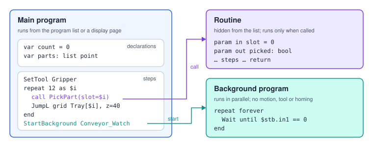

# Program Structure

A program is a **list of steps** plus the **variables** it declares. The controller runs the steps
from top to bottom; flow-control steps (loops, branches, calls, jumps) change that order. Some
steps have **bodies** — the steps inside a loop, the branches of an `if`, the body and catch of a
`try` — so a program is really a tree of steps.

## Program kinds



| Kind | Runs when | Notes |
|---|---|---|
| **Program** | started by the operator (program list, monitor, a display page or a station tag) | The normal case. |
| **Routine** | called by Call Routine (`call`) from another program | Hidden from the program list. Can take parameters — see [Routines and Parameters](#routines). |
| **Background program** | started by Start Background (`StartBackground`) | Runs in parallel with the main program. Motion, tool and homing steps are skipped — see [Background Programs](#background). |

The kind is set in **Program Settings**. In an exported `.srs` file it travels in the
`@program {…}` header (`"isRoutine": true`, `"isBackground": true`).

## Steps

Every step, whatever its type, carries the same few common properties:

| Property | In Blocks | In text | Meaning |
|---|---|---|---|
| type | the card's kind | the keyword (`MoveL`, `if` …) | What the step does. |
| name | the card title (pencil icon) | `@name "…"` above the step | An optional label shown instead of the summary. |
| comment | the step's description | `# …` lines directly above the step, or at the end of its line | Free text, never executed. |
| enabled | the power button on the card | `@off` above the step | A disabled step is skipped — and its whole body with it. |
| id | hidden | `@id "…"` (only when asked for) | A stable identifier. Breakpoints, the monitor and links between steps use it. |

> **Note** A disabled step still counts in the step total and is logged as
> `[Skipped — disabled]` when the program passes it. The validator reports it once
> (`disabledStep`, a warning) and does not check anything inside it.

## Sections and notes

A **Note** step is not executed and does not count as a step. It has two styles:

- **Section** — a header that groups the steps below it; the editor can collapse a section.
  In text: a line starting with `##`.
- **Note** — a paragraph of explanation. In text: a comment paragraph followed by a blank line,
  `end`, or the end of the file.

```srs
## Pick                      # a section header

# Check the tray first.      # a comment paragraph followed by a blank line:
# Then pick.                 # a Note step

# Approach slowly            # comment lines directly above a statement: its comment
@name "Approach"             # the step's name
MoveL Pick1, speed=50
```

## The layout of a text program

```srs
#!srs 1
@program {"name": "Pick and place", "isRoutine": false}   # only in exported files
var count = 0                                             # declarations first
var parts: list point
## Setup                                                  # then the steps
SetTool Gripper
```

| Element | Rule |
|---|---|
| `#!srs 1` | The language version. The formatter writes it; the parser accepts text without it. |
| `@program {…}` | Name, kind and display page of an exported file. Read only when importing. |
| Declarations | `var`, `computed` and `param` lines. The formatter puts them first. |
| Statements | One per line. A line continues while a `(`, `[` or `{` is open, or after a trailing `,`. |
| Blocks | `if`, `repeat`, `while`, `for`, `switch`, `try` and the row bodies (`RunVision`, `HttpRequest` …) close with `end`. |
| Comments | `#` to the end of the line, outside strings. |
| Case | Keywords are case-insensitive; the formatter writes the canonical spelling and indents with two spaces. |

The formatter is canonical: formatting a program, parsing it and formatting it again gives the same
text. A step can carry fields the text has no words for (left over from an older editor, or a CNC
toolpath); those travel in an `@with {…}` JSON line above the step. Leave `@with` lines as they are.

## Names and ids

Programs refer to points, tools, local frames, grids, stacks, routines, devices, cameras and vision
programs **by name in the editor, but by id in storage**. A renamed point keeps working, and the text
shows its new name.

- A name that is a plain identifier is written bare: `MoveL Pick1`.
- Any other name can be written in quotes (`MoveL "Pick 1"`) or in its **underscore form**, where
  every run of characters an identifier cannot hold becomes one `_`: `"Pick 1"` → `Pick_1`,
  `"Arduino Nano"` → `Arduino_Nano`.
- Names match exactly first, then ignoring case, then by underscore form. If an underscore form fits
  two names (`"Pick 1"` and `"Pick-1"`), write the quoted name (`ambiguousName`).
- An unknown name is a **warning**, not an error: you can write a program before teaching its points.
  The validator keeps reporting it until the point exists.

## Saving, revisions and files

- **Save** stores the program on the controller. Every save that changes the program first keeps the
  previous version as a **revision**; the newest 30 are kept. The history button in the editor lists
  them and can restore one (restoring is itself a new revision).
- A program can be exported and imported as a `.srs` text file. Importing creates fresh step ids.
- Parse errors block saving in Text view; validation errors do not block saving, they block running.

## Program settings

| Setting | Meaning |
|---|---|
| Name, description, image | Shown in the program list and on the monitor. |
| Kind | Program, routine or background program. |
| Display page | An optional operator page for the program (buttons, values, images). Variables marked `input` can be set from it at start. |
