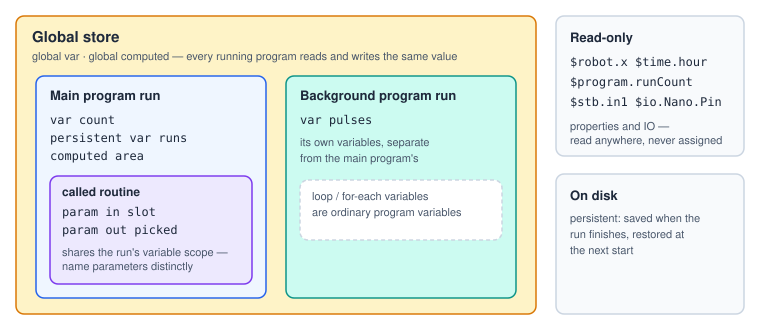

# Data and Variables

Programs keep data in **variables**. A variable has a name, a type, an initial value and a few
optional modifiers. In expressions and text it is always written with a `$`: `$count`.

## Declaring variables

In Blocks, variables are listed and edited in the **Variables** panel. In text they are declared at
the top of the program:

```srs
var count = 0                     # Parts placed      ← a trailing comment is the description
var ok: bool = off
var label: string = "Bin {$i}"
var startZ = $robot.z             # an expression → computed once at program start
var pts: list point = ((x=1, y=2, z=3), (x=4, rz=90))
var vals: list number = (1, 2.5, 3)
var flags: list bool = (on, off)
var cells: list record = ((row=0, col=1), (row=1, col=0))
var photo: image
var lap: stopwatch
computed area = $w * $h           # a formula, evaluated every time it is read
global persistent input monitor var runs = 0   # modifiers, in this order
param in height = 20              # routine parameters: in | out | inout
```

## Types

| Type | Text | Holds | Notes |
|---|---|---|---|
| Number | `number` (the default) | a floating-point number | |
| Boolean | `bool` | 1 or 0 | Shown as true / false. Any non-zero value counts as true. |
| Text | `string` | text | Assigned with a template in quotes: `$label = "Bin {$i}"`. |
| Image | `image` | a camera frame (JPEG) | Filled by Capture Image or a plugin; sent by HTTP Request or Export Data. |
| Stopwatch | `stopwatch` | elapsed milliseconds | Driven by the Stopwatch step. |
| List | `list number \| bool \| point \| record` | a list of elements | See below. |

> **Note** Expressions work with numbers. Booleans are stored as 1 / 0, so a comparison can be
> assigned straight to a boolean: `$ok = $grams > 100`. In an expression write `true` / `false`;
> the words `on` / `off` are for declarations and step options.

## Modifiers

| Word | Field | Meaning |
|---|---|---|
| `global` | `isGlobal` | Shared with every running program — see the figure below. |
| `persistent` | `isPersistent` | Saved when the run finishes and restored at the next start. |
| `input` | `isInput` | A display page may set it when the program starts. |
| `monitor` | `displayOnMonitor` | Shown on the monitor while the program runs. |
| `computed` | `isComputed` | A formula instead of a stored value. |
| `param in / out / inout` | `paramMode` | A routine parameter. |



## Initial values

A number or boolean variable can start from an **expression** instead of a literal:
`var startZ = $robot.z`. The expression is evaluated **once when the program starts** (and again each
time a routine is entered), in declaration order — it can read variables declared *above* it, plus IO
and properties.

## Lists

There is one list type; the **element type** says what the elements are.

| Element type | One element | Read as | Typical source |
|---|---|---|---|
| Number | a number | `$vals[$i]` | typed in, List step, plugin |
| Boolean | 1 / 0 | `$flags[$i]` | typed in |
| Point | `x y z rx ry rz` | `$pts[$i].x`, or `$pts[$i][2]` for z | Run Vision `points`, Save Position, stop conditions |
| Record | named numeric fields | `$recs[$i].coverage` | Run Vision `cells` / `items`, recordings |

- `$list.length` and `$list.count` give the number of elements; `len($list)` does the same.
- In an expression an index out of range, or an unknown field, reads as **0** rather than failing.
- Only a **Point** list can be a move target (`MoveL $pts[$i]`).
- Lists are changed with the [List](#ref-ListOp) step: `append`, `insert`, `removeAt`, `clear`,
  set an element or field, `sort`, `reverse`, `copyFrom`.

```srs
var pts: list point
$pts.append(x=$robot.x, y=$robot.y, z=50)   # add an element
$pts.append()                               # append the current position
$pts[0].z = 30                              # set one field
for _, $i in $pts                           # walk it
  MoveL $pts[$i]
end
```

> **Note** A List step evaluates everything before it changes the list, so a failing step leaves
> the list as it was. The declared list itself is never changed: the next run starts from it again.

## Computed variables

A **computed** variable is a named formula — a property you define. Its expression is evaluated
**every time** it is read, against the live variables, IO and properties.

```srs
computed area = $w * $h
computed ready: bool = $area > 100 and $stb.in1
```

- It has no stored value and cannot be assigned (`computedVariable`, fatal).
- Formulas may use variables declared below them, and other computed variables — but not in a cycle
  (`computedCycle`).
- A `global computed` variable is registered by the program that declares it and readable from every
  program; its formula may only use global variables, IO and properties.
- It cannot also be `persistent`, a string, an image, a stopwatch or a list.

## Text in templates

Text fields — status messages, prompts, file paths, a string variable's value — are **templates**:
variable references inside them are filled in when the step runs.

| Form | Result |
|---|---|
| `$name` or `{$name}` | The value. A list gives a count: `"3 points"`. |
| `{$name[expr]}` | One element: a number, `True`/`False`, `(x=…, y=…)` for a point. |
| `{$name[expr].z}` | One field of an element. |
| `{expr}` | Any expression: `{$index + 1}`, `{round($mm, 1)}`, `{$robot.z}`. |

Braces let a reference sit against other text (`{$prefix}{$index}` → `bin3`) and are needed for
properties and full expressions. Anything that does not resolve is left in the text as written.

## Built-in values

| Name | Value |
|---|---|
| `$time_ms` | Unix time in milliseconds — handy in file names: `"shots/{$time_ms}.jpg"`. |
| `$robot.*`, `$program.*`, `$time.*`, `$aux.*`, `$camera.*` | Read-only properties — see [Functions and Properties](#functions). |
| `$stb.in1`, `$relay.3`, `$io.<device>.<pin>` | Live IO values. |

Properties and IO names can be read anywhere but never assigned (`readOnlyProperty`). A variable of
the same name wins over a property.
