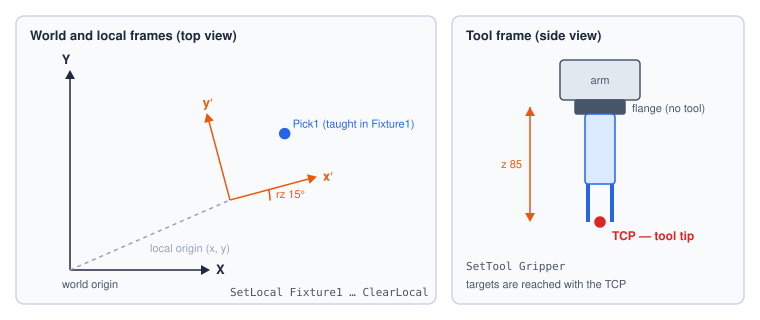
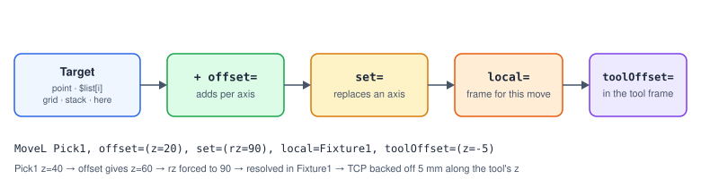

# Points, Frames and Tools

Motion steps send the robot to **targets**. This chapter explains where targets come from and which
coordinate frame they are measured in.

## Positions

A position (a *pose*) has six values: `x y z` in millimetres and `rx ry rz` in degrees. Positions
are measured at the **tool centre point** (TCP) — the flange when no tool is active, the tool tip
when one is.

## Saved points

A **point** is a named, saved position. Points are taught by jogging the robot and pressing *Teach*
(or with Save Position from a program), and edited under **Space → Points**. Programs refer to them
by name; storage links them by id, so renaming a point does not break programs.

```srs
MoveL Pick1                 # by name
MoveL "Pick 1"              # a name with a space, quoted …
MoveL Pick_1                # … or in its underscore form
```

Every change to a point is recorded in the points history.

## Frames



| Frame | What it is | Set with |
|---|---|---|
| **World** (base) | The robot's own coordinate system. | Always there; Clear Local returns to it. |
| **Local** | A named frame offset and turned from the world frame — a fixture, a tray, a machine. | [Set Local](#ref-SetLocal) for the moves that follow, or `local=` on one move. |
| **Tool** | The offset from the flange to the tool tip. | [Set Tool](#ref-SetTool). |

Use a local frame whenever a group of points belongs to something that can move: teach the points
in the local frame, and if the fixture moves, re-teach only the frame.

```srs
SetLocal Fixture1
MoveL here, offset=(x=10, y=10)   # 10 mm along the fixture's own x and y
ClearLocal
```

## Tools

A **tool** describes the gripper, probe or other end effector: the offset `x y z rx ry rz` from the
flange to its tip. With a tool active, targets are reached with the tip, and tool-frame offsets move
along the tool's own axes. Tools are edited under **Space → Tools**.

```srs
SetTool Gripper
MoveL Pick1          # the gripper tip goes to Pick1
SetTool Probe
MoveL Pick1          # now the probe tip goes there
```

## Targets

A move's target is one of:

| Target | Text | Notes |
|---|---|---|
| A saved point | `MoveL Pick1` | |
| An element of a Points list | `MoveL $pts[$i]` | The index is an expression. |
| A template naming a point | `MoveL "bin{$i}"`, `MoveL $target` | Filled in, then looked up by name; `pointNotFound` if nothing matches. |
| A grid cell | `MoveL grid Tray[$r, $c]` or `grid Tray[$n]` | See below. |
| A stack slot | `MoveL stack Bins[$i]` | See below. |
| Here | `MoveL here, offset=(z=20)` | No target: the move starts from the current position, so offsets are relative. |

## Offsets, overrides and frames on a move



| Modifier | Text | Effect |
|---|---|---|
| Offset | `offset=(x=…, z=…)` | Added to the target, per axis. |
| Override | `set=(z=30)` | Replaces an axis of the result outright. |
| Tool offset | `toolOffset=(z=-5)` | Applied in the tool frame at execution time — e.g. back off along the tool axis. |
| Local frame | `local=Fixture1` | Resolve this one move in another frame. |

Each axis value may be an expression: `offset=(z=$layer * 5)`.

## Grids and stacks

![A grid addresses cells by [row, col] or by index (row-major: index = row × columns + col). A stack addresses slots base + index × offset.](../figures/grid-stack.svg)

A **grid** is a base point plus a row offset and a column offset (and optionally a rotation about the
base's Z). Cell `[row, col]` is *base + row × row offset + col × column offset*. With a column count
set, a single index also works: `Tray[6]` is row 1, column 2 of a four-column grid.

A **stack** is a base point plus an offset per slot: slot *i* is *base + i × offset*. With a maximum
count set, the index wraps round.

Both are edited under **Space**. The validator reports `untaughtGrid` (a warning) for a grid or stack
whose offsets are all zero — every cell would be the same position.

## Saving the current position

[Save Position](#ref-SavePosition) stores where the robot is — into a Points list or into a saved
point:

```srs
var taught: list point
SavePosition $taught, mode=append      # build a path by teaching
SavePosition point Pick1               # overwrite (or create) a saved point
```

The position is expressed in the program's active local frame, so moving to it later under the same
local lands on the same spot.
