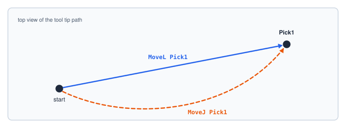
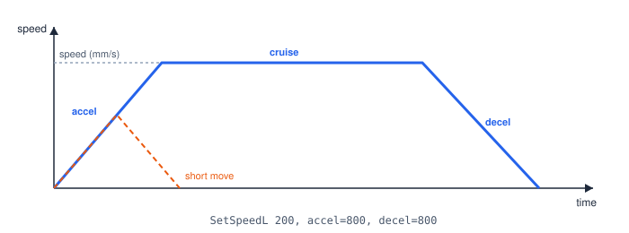
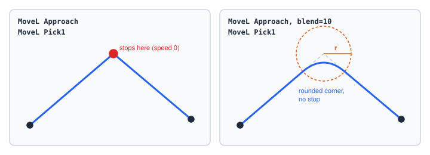
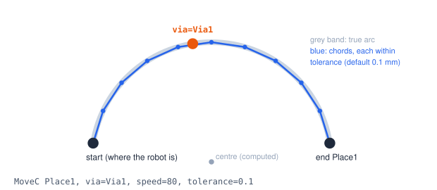
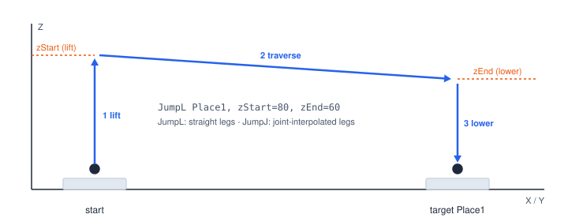
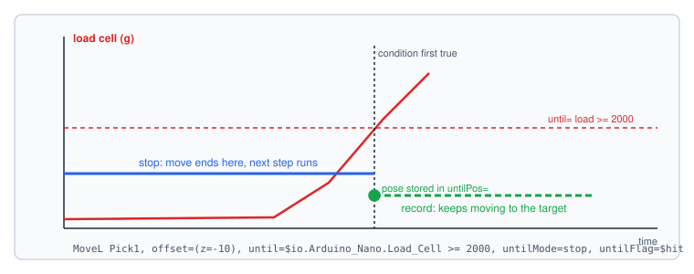

# Motion

| Step | Keyword | Path |
|---|---|---|
| [Move Linear](#ref-MoveL) | `MoveL` | Straight line to the target. |
| [Move Joint](#ref-MoveJ) | `MoveJ` | Joint-interpolated: all joints start and stop together. |
| [Jump Linear / Joint](#ref-JumpL) | `JumpL` / `JumpJ` | Lift, traverse, lower — the pick-and-place move. |
| [Move Arc](#ref-MoveC) | `MoveC` | Circular arc through a via point. |
| [Move to Joints](#ref-MoveJoints) | `MoveJoints` (`MoveAbsJ`) | Joint-interpolated to explicit joint values — no Cartesian target. |
| [Thread Move](#ref-ThreadMove) | `ThreadMove` | Z travel synchronised with RZ rotation. |
| [CNC Program](#ref-CncProgram) | `CncProgram` | A toolpath from a DXF or SVG file. |
| [Run Homing](#ref-RunHoming) | `RunHoming` | The full homing sequence. |

All motion steps are **skipped in background programs**.

## Linear and joint moves



- Use **MoveL** when the path matters: approaching a part, inserting, following an edge.
- Use **MoveJ** to travel through open space, where the exact path does not matter: it is usually
  faster. Check that the curved path is clear of obstacles.

```srs
MoveJ Home
MoveL Approach
MoveL Pick1, speed=50
```

## Speed, acceleration and deceleration



| Where | Sets |
|---|---|
| [Set Speed (Linear)](#ref-SetSpeedL) `SetSpeedL 200, accel=800, decel=800` | Defaults for later linear moves. |
| [Set Speed (Joint)](#ref-SetSpeedJ) `SetSpeedJ 60` | Defaults for later joint moves. |
| `speed=` `accel=` `decel=` on one move | This move only. |
| [Set Speed Factor](#ref-SetSpeedFactor) `SetSpeedFactor 50` | Scales every later move of this program, 1–100 %. |
| The operator's **speed override** (monitor, 5–200 %) | Scales every program move. |

The speed a program move actually runs at is *speed × operator override × speed factor / 100*. The
speed factor can only slow a program down; manual jogging is never affected by either. Read the
current values in expressions as `$robot.speedS`, `$robot.speedOverride` and `$program.speedFactor`.

## Motion profile: trapezoid or S-curve

By default every move ramps with constant acceleration — a **trapezoid** speed profile, the
acceleration stepping on and off. The robot configuration's **Motion profile** can select an
**S-curve** instead: a jerk-limited profile in which the acceleration itself ramps up and down,
so the start and stop are smoother and excite less vibration.

| Setting | Meaning |
|---|---|
| Motion profile | `trapezoid` (default) or `scurve`. |
| Smoothness (1–100 %, default 50) | The share *f* of each acceleration phase spent ramping the acceleration. 100 % = no constant-acceleration part at all. |
| Jerk (optional) | An absolute jerk limit (mm/s³ for linear moves, joint units/s³ for joint moves). Empty = derived from the smoothness: *jerk = a² (2 − f) / (f · v<sub>max</sub>)*. |

A single move can pick its own profile with `profile=`:

```srs
MoveL Pick1, profile=scurve
JumpJ Place1, z=60, profile=trapezoid
```

With the same speed and acceleration an S-curve move takes a little longer than a trapezoid
one — the ramps are gentler — so raise the acceleration a little if cycle time matters. Blended
paths, Jumps and arcs use it along the whole path. Homing and jogging always keep the trapezoid.

## Moving to joint values

[Move to Joints](#ref-MoveJoints) moves straight to joint values, with no Cartesian target and no
inverse kinematics (RAPID `MoveAbsJ`). Joints follow the robot's joint-limit layout: on ASTRO
`j1` is the base rotation (°), `j2` the radial reach (mm), `j3` the vertical (mm) and `j4` the tool
rotation (°); on a CNC they are X, Y, Z and RZ. A joint left empty keeps its current value.

```srs
var home: list record
SavePosition $home, source=joints               # capture the joints here: {j1, j2, j3, j4}
MoveJoints j1=90, j2=250, j3=120, j4=0, speed=50
MoveJoints $home[0], j4=45                      # a saved joints value, one joint changed
MoveJoints (jointsOf("Pick1"))                  # the joints that reach a saved point
```

A joint value outside its soft limit fails with `outOfReach` before the robot moves.

## Reach checks

Every move checks its target **before** it starts: the inverse kinematics must solve and every
joint must be inside its soft limits. A Move Linear checks its whole line, a Jump its lift and
traverse points, a blended run every corner and an arc every point. An unreachable target fails
with the catchable `outOfReach`, so a [Try](#errors) can skip a part instead of stopping the cell.
To ask without moving, use `reachable(…)` and `jointsOf(…)` ([Expressions](#expressions)).

## Blending



A Move Linear (or the traverse of a Jump) with `blend=` does not stop on its point: it rounds the
corner into the next blend-enabled move, and a run of blended moves becomes one continuous path.

```srs
SetBlendRadius 5
MoveL Approach, blend=on        # uses the radius set above
MoveL Via1, blend=10            # its own 10 mm radius
MoveL Pick1                     # not blended: stops exactly here
```

- `blend=on` uses the radius from [Set Blend Radius](#ref-SetBlendRadius); `blend=<mm>` or
  `blend=$r` gives one. `blend=off` stops.
- The robot does not pass exactly through a blended point — it stays within the radius of it. Do not
  blend into a point you must reach exactly (a pick or place).
- A move with a stop condition never blends.

## Arcs



```srs
MoveL Pick1                                  # the arc starts where the robot is
MoveC Place1, via=Via1, speed=80, tolerance=0.1
```

The orientation changes linearly from the start's to the end's; the via point's orientation is not
used. Start, via and end on one line fail with `arcDegenerate`.

## Jumps



A Jump is three moves in one step — the classic pick-and-place motion:

```srs
JumpL Place1, z=60                  # lift to Z 60, travel, lower onto Place1
JumpJ grid Tray[$i], z=80, zEnd=50  # joint legs; lower from Z 50
```

`JumpL` uses straight legs; `JumpJ` uses joint-interpolated legs (faster, curved traverse).

## Stop conditions — move until



Move Linear, Move Joint, the Jumps, Aux Move and Gripper can watch a **condition** while they move.
The common case is "move with force": press down until a load cell reads a limit.

```srs
var hit = 0
var touch: list point
MoveL Pick1, offset=(z=-10), until=$io.Arduino_Nano.Load_Cell >= 2000, untilFlag=$hit
MoveL Pick1, offset=(z=-10), until=$stb.in2, untilMode=record, untilPos=$touch
```

| Argument | Meaning |
|---|---|
| `until=` | The condition, checked every controller tick while the move runs. |
| `untilMode=stop` (default) | End the move where it is the first time the condition holds, and continue with the next step — no error, no pause. |
| `untilMode=record` | Let the move finish; store the position where the condition first held. |
| `untilPos=$v` | Receives that position: a one-element Points list (`$v[0].z`), or a number for an aux axis. |
| `untilFlag=$v` | 1 if the condition fired during the move, else 0. |

On a Jump the watch spans all three legs; in stop mode the remaining legs are skipped.

## Homing and manual homing

`RunHoming` runs the full homing sequence and waits for it. `SetJointPosition J4, 0` declares a
joint's current value without moving it (manual homing). `$robot.homed` tells whether the robot has
been homed:

```srs
if not $robot.homed
  RunHoming
end
```

## Errors from motion

| Code | Catchable | When |
|---|---|---|
| `pointNotFound` | yes | A template or list target names no saved point. |
| `arcDegenerate` | yes | Move Arc points on one line. |
| `outOfReach` | yes | Checked before the move: the target has no inverse kinematics solution, or a joint would be outside its soft limits. |
| `motionFault` | no | The motion system reports a fault. |
| `jointLimit` | no | A joint crosses its soft limit while the robot is moving. |
| `driverDisconnected` | no | The motor driver is not connected. |
| `emergencyStop` | no | The emergency stop was pressed. |
