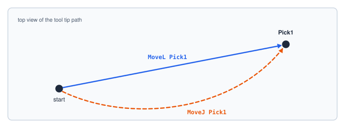
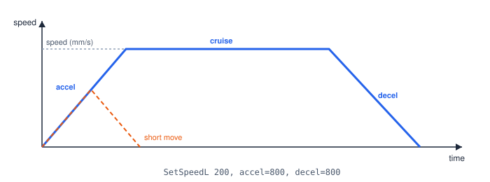
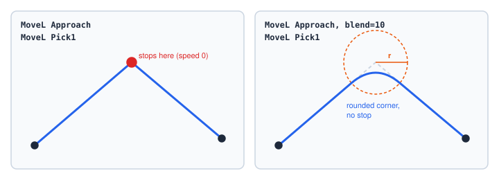
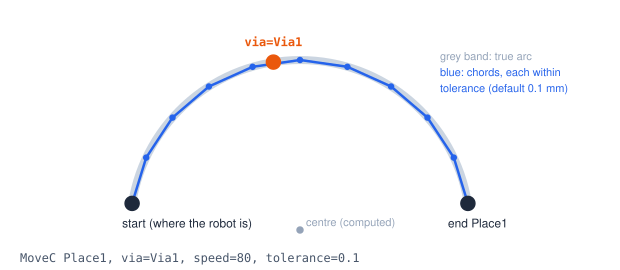
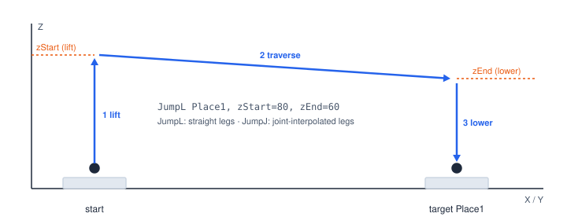
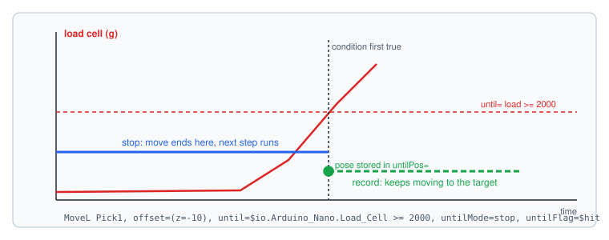

# Motion

| Step | Keyword | Path |
|---|---|---|
| [Move Linear](#ref-MoveL) | `MoveL` | Straight line to the target. |
| [Move Joint](#ref-MoveJ) | `MoveJ` | Joint-interpolated: all joints start and stop together. |
| [Jump Linear / Joint](#ref-JumpL) | `JumpL` / `JumpJ` | Lift, traverse, lower — the pick-and-place move. |
| [Move Arc](#ref-MoveC) | `MoveC` | Circular arc through a via point. |
| [Thread Move](#ref-ThreadMove) | `ThreadMove` | Z travel synchronised with RZ rotation. |
| [CNC Program](#ref-CncProgram) | `CncProgram` | A toolpath from a DXF or SVG file. |
| [Run Homing](#ref-RunHoming) | `RunHoming` | The full homing sequence. |

All motion steps are **skipped in background programs**.

## Linear and joint moves



- Use **MoveL** when the path matters: approaching a part, inserting, following an edge.
- Use **MoveJ** to travel through open space, where the exact path does not matter: it is usually
  faster. Check that the curved path is clear of obstacles.

```srs
MoveJ Home
MoveL Approach
MoveL Pick1, speed=50
```

## Speed, acceleration and deceleration



| Where | Sets |
|---|---|
| [Set Speed (Linear)](#ref-SetSpeedL) `SetSpeedL 200, accel=800, decel=800` | Defaults for later linear moves. |
| [Set Speed (Joint)](#ref-SetSpeedJ) `SetSpeedJ 60` | Defaults for later joint moves. |
| `speed=` `accel=` `decel=` on one move | This move only. |
| [Set Speed Factor](#ref-SetSpeedFactor) `SetSpeedFactor 50` | Scales every later move of this program, 1–100 %. |
| The operator's **speed override** (monitor, 5–200 %) | Scales every program move. |

The speed a program move actually runs at is *speed × operator override × speed factor / 100*. The
speed factor can only slow a program down; manual jogging is never affected by either. Read the
current values in expressions as `$robot.speedS`, `$robot.speedOverride` and `$program.speedFactor`.

## Blending



A Move Linear (or the traverse of a Jump) with `blend=` does not stop on its point: it rounds the
corner into the next blend-enabled move, and a run of blended moves becomes one continuous path.

```srs
SetBlendRadius 5
MoveL Approach, blend=on        # uses the radius set above
MoveL Via1, blend=10            # its own 10 mm radius
MoveL Pick1                     # not blended: stops exactly here
```

- `blend=on` uses the radius from [Set Blend Radius](#ref-SetBlendRadius); `blend=<mm>` or
  `blend=$r` gives one. `blend=off` stops.
- The robot does not pass exactly through a blended point — it stays within the radius of it. Do not
  blend into a point you must reach exactly (a pick or place).
- A move with a stop condition never blends.

## Arcs



```srs
MoveL Pick1                                  # the arc starts where the robot is
MoveC Place1, via=Via1, speed=80, tolerance=0.1
```

The orientation changes linearly from the start's to the end's; the via point's orientation is not
used. Start, via and end on one line fail with `arcDegenerate`.

## Jumps



A Jump is three moves in one step — the classic pick-and-place motion:

```srs
JumpL Place1, z=60                  # lift to Z 60, travel, lower onto Place1
JumpJ grid Tray[$i], z=80, zEnd=50  # joint legs; lower from Z 50
```

`JumpL` uses straight legs; `JumpJ` uses joint-interpolated legs (faster, curved traverse).

## Stop conditions — move until



Move Linear, Move Joint, the Jumps, Aux Move and Gripper can watch a **condition** while they move.
The common case is "move with force": press down until a load cell reads a limit.

```srs
var hit = 0
var touch: list point
MoveL Pick1, offset=(z=-10), until=$io.Arduino_Nano.Load_Cell >= 2000, untilFlag=$hit
MoveL Pick1, offset=(z=-10), until=$stb.in2, untilMode=record, untilPos=$touch
```

| Argument | Meaning |
|---|---|
| `until=` | The condition, checked every controller tick while the move runs. |
| `untilMode=stop` (default) | End the move where it is the first time the condition holds, and continue with the next step — no error, no pause. |
| `untilMode=record` | Let the move finish; store the position where the condition first held. |
| `untilPos=$v` | Receives that position: a one-element Points list (`$v[0].z`), or a number for an aux axis. |
| `untilFlag=$v` | 1 if the condition fired during the move, else 0. |

On a Jump the watch spans all three legs; in stop mode the remaining legs are skipped.

## Homing and manual homing

`RunHoming` runs the full homing sequence and waits for it. `SetJointPosition J4, 0` declares a
joint's current value without moving it (manual homing). `$robot.homed` tells whether the robot has
been homed:

```srs
if not $robot.homed
  RunHoming
end
```

## Errors from motion

| Code | Catchable | When |
|---|---|---|
| `pointNotFound` | yes | A template or list target names no saved point. |
| `arcDegenerate` | yes | Move Arc points on one line. |
| `motionFault` | no | The motion system reports a fault. |
| `jointLimit` | no | A target is outside a joint's soft limits. |
| `driverDisconnected` | no | The motor driver is not connected. |
| `emergencyStop` | no | The emergency stop was pressed. |
