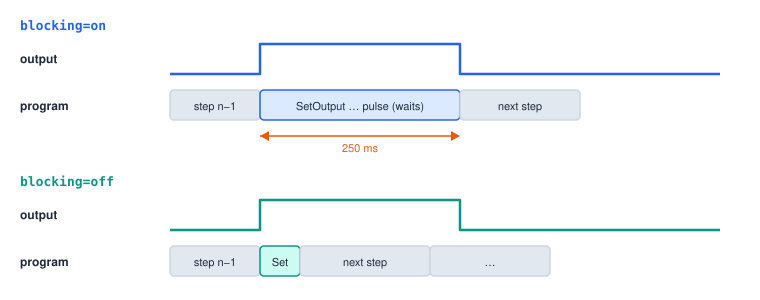
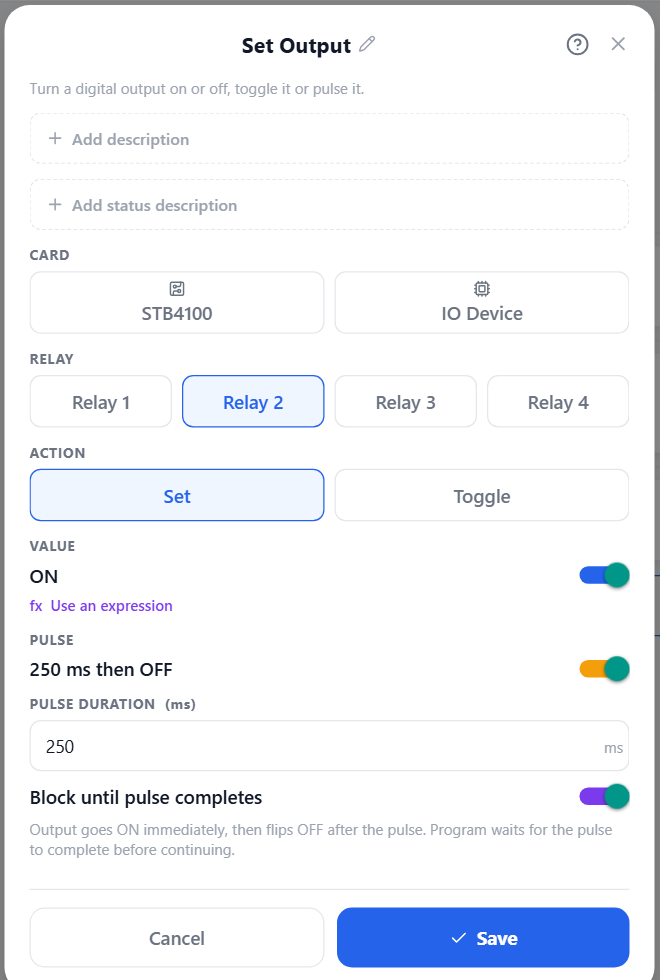
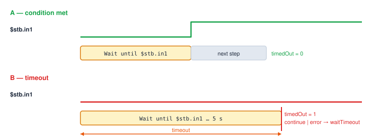
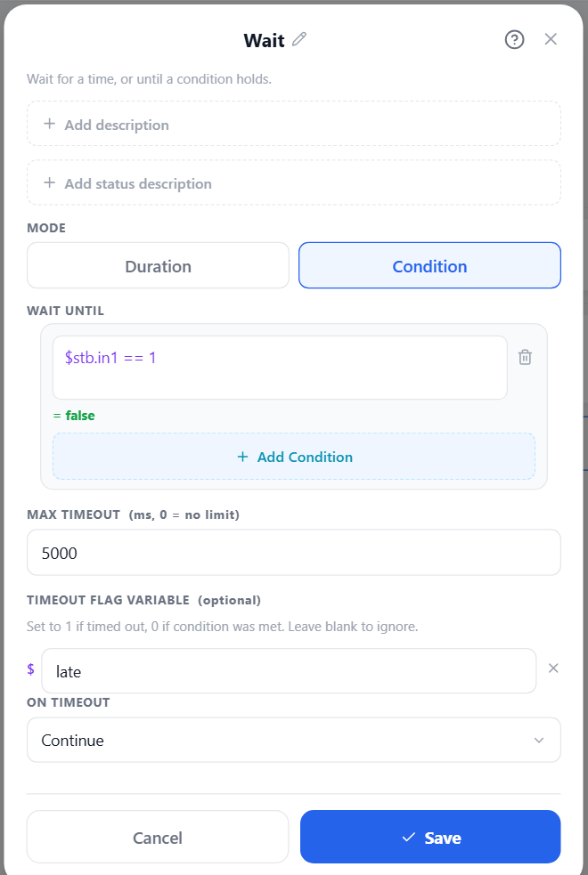

# I/O, Waits and Aux Axes

## Where I/O lives

| Card | In text | Outputs | Read in expressions |
|---|---|---|---|
| Driver board | `stb` | 1–4 | `$stb.in1` … `$stb.in4`, `$stb.out1` … `$stb.out4` |
| USB relay | `relay` | channels 1–4 | `$relay.1` … `$relay.4` |
| IO device (e.g. Arduino Nano) | `io <device>` | its output pins | `$io.<device>.<pin>` (digital 1 / 0, load cell in grams) |

Pins and relays can be given friendly names under **I/O**; names with spaces are written in their
underscore form in expressions (`$io.Arduino_Nano.Load_Cell`).

## Setting outputs

```srs
SetOutput stb 1 on                         # card number value
SetOutput relay 3 off
SetOutput io Arduino_Nano 7 on             # an IO device pin
SetOutput stb 2 toggle                     # flip the current state
SetOutput stb 2 ($count > 3)               # an expression: non-zero = on
SetOutput relay 2 on, pulse=250ms          # on for 250 ms, then off again
SetOutput relay 2 on, pulse=250ms, blocking=on
```



A pulse always returns the output to the opposite of the state the step set, so a toggle pulse flips
the output and flips it back.



## Waiting

[Wait](#ref-Wait) pauses the program for a time, or until a condition holds.

```srs
Wait 500ms                                  # a fixed time (also: Wait 2s, Wait $delay)
Wait until $stb.in1 == 1                    # until an input comes on — forever if need be
Wait until $stb.in1, timeout=5s, timedOut=$late
Wait until $stb.in1, timeout=5s, onTimeout=error
```



| Argument | Meaning |
|---|---|
| `timeout=` | Give up after this long. Empty or 0 waits forever. |
| `timedOut=$v` | Set to 1 when the wait timed out, 0 when the condition held. Created if not declared. |
| `onTimeout=continue` | (Default) carry on with the next step; check `$v` yourself. |
| `onTimeout=error` | Fail with `waitTimeout` — catch it with a [Try](#errors) to retry or recover. |

The condition is checked every controller tick; one that holds on the tick the timeout falls due counts
as met.



## Handshakes

A typical handshake with another machine: raise a request, wait for its answer with a timeout, drop
the request.

```srs
var late: bool = off
SetOutput stb 1 on                               # "part ready"
Wait until $stb.in2, timeout=10s, timedOut=$late # "taken"
SetOutput stb 1 off
if $late
  status warning "No answer from the machine"
end
```

## Load cells

An IO device pin configured as a load cell reads a calibrated weight. In expressions it is always in
**grams**; [Read Load Cell](#ref-ReadLoadCell) can convert to kg, N, lb or oz.

```srs
var grams = 0
var rec: list record
Tare device=Arduino_Nano, pin=2                       # zero it
ReadLoadCell $grams, device=Arduino_Nano, pin=2       # into a variable
StartRecording $rec, device=Arduino_Nano, pin=2       # record while moving …
MoveL Pick1, until=$io.Arduino_Nano.Load_Cell >= 2000 # … press until 2 kg
StopRecording device=Arduino_Nano, pin=2              # … samples {t, v, r} land in $rec
ExportData csv "logs/press-{$time_ms}.csv"
  "series" = list $rec
end
```

## Aux axes, grippers, conveyors and rotary tables

Auxiliary stepper axes are driven by an aux card. Each axis has a role set under **I/O**; the
role-specific steps use its configured distances and speeds.

| Step | Use |
|---|---|
| [Aux Move](#ref-AuxMove) | Move by a distance (`unit=mm` / `deg`) or raw `steps=`; `absolute=on` to go to a position; `wait=off` to fire and forget. |
| [Aux Continuous Run](#ref-AuxContinuous) | Run at a velocity until [Aux Stop](#ref-AuxStop). |
| [Aux Motor Enable](#ref-AuxEnable) | Enable or disable the drivers. |
| [Gripper](#ref-GripperAction) | Open, close, or grip to a jaw gap. Takes a stop condition (close until a grip force). |
| [Conveyor](#ref-ConveyorAction) | Forward, reverse or stop. |
| [Rotary Index](#ref-RotaryIndex) | Turn a number of positions. |

```srs
GripperAction open
GripperAction close, until=$io.Arduino_Nano.Input_1 >= 300
ConveyorAction forward, device=Aux_Stepper, axis=2
Wait until $stb.in1
ConveyorAction stop, device=Aux_Stepper, axis=2
RotaryIndex +1, count=3, device=Aux_Stepper, axis=3
```

Aux positions read as `$aux.<deviceId>.<axis>.position` (steps) and `$aux.<deviceId>.moving`.
Aux steps run in background programs too.
