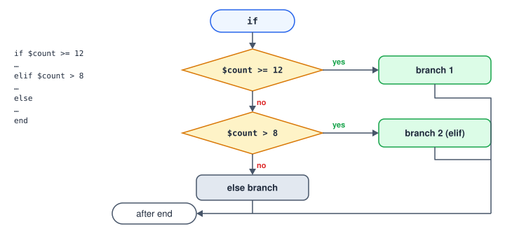
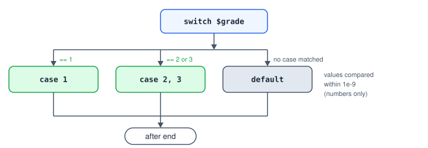
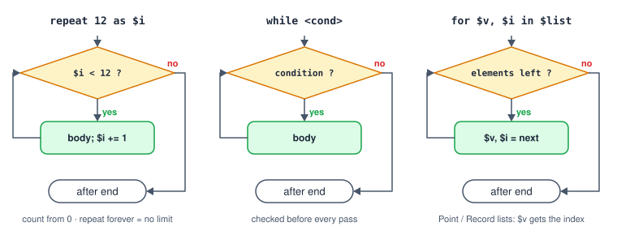

# Flow Control

| Step | Text | Use |
|---|---|---|
| [If Condition](#ref-IfCondition) | `if … elif … else … end` | Choose between branches. |
| [Switch](#ref-Switch) | `switch … case … default … end` | Choose by a number. |
| [Loop](#ref-Loop) | `repeat`, `while`, `for … in` | Repeat steps. |
| [Break / Next](#ref-LoopControl) | `break`, `continue` | Leave a loop / skip to its next pass. |
| [Label](#ref-Label) / [Go To Label](#ref-GoToLabel) | `label`, `goto` | Jump to a marked place. |
| [Call Routine](#ref-CallRoutine) / [Return](#ref-Return) | `call`, `return` | Run a routine — see [Routines](#routines). |
| [End Program](#ref-EndProgram) | `exit` | Finish now, from anywhere. |
| [Pause Program](#ref-PauseProgram) | `pause` | Pause until the operator continues. |
| [Try](#ref-Try) / [Raise Error](#ref-RaiseError) | `try … catch … end`, `raise` | Handle errors — see [Error Handling](#errors). |

## If, elif, else



```srs
if $count >= 12
  status "Tray full"
  exit
elif $count > 8                # "else if" works too
  status warning "Almost full"
else
  JumpL grid Tray[$count], z=40
end
```

In Blocks the branches of an If are shown side by side; tap **Enter** to edit a branch's steps and
**+ ELSE IF** to add a branch.

## Switch



```srs
switch $grade
case 1
  MoveL Place1
case 2, 3                      # several values for one case
  MoveL stack Bins[0]
default
  raise "Unknown grade {$grade}", code=badGrade
end
```

Switch compares numbers. To branch on text use `if $s.contains("…")`.

## Loops



```srs
repeat 12 as $i                # $i = 0, 1, … 11
  JumpL grid Tray[$i], z=40
end

repeat forever                 # until stopped, or break
  Wait until $stb.in1
  …
end

while $stb.in1 == 0            # checked before every pass
  Wait 10ms
end

for $v, $i in $vals            # Number / Boolean list: $v is the element
  $sum = $sum + $v
end
for _, $i in $parts            # Point / Record list: use the index
  JumpL $parts[$i], z=40
end
```

The loop variables (`as $i`, `$v`, `$i`) are ordinary program variables, readable in any expression
inside the body. A count of 0 (`repeat forever`) has no limit.

### Break and next

```srs
repeat forever
  if $stb.in2                  # stop button
    break                      # → continues after end
  end
  if not $stb.in1
    continue                   # → next pass
  end
  …
end
```

`break` and `continue` act on the nearest enclosing loop, leaving any branches and Try bodies in
between. A step after `repeat forever` can only run if the loop has a `break` of its own — one
inside a nested loop only ends that loop — otherwise the validator flags it as unreachable. They never cross a routine boundary: a `break` in a routine called from a loop is an error
(`loopControlOutsideLoop`).

## Labels and Go To

```srs
label again
Wait until $stb.in1, timeout=5s, timedOut=$late
if $late
  goto again
end
```

`goto` jumps to a label in the same program (or the same routine). Loops usually express the same
thing more clearly; use labels for the occasional retry or skip.

## Ending and pausing

- `exit "message"` finishes the program with **Complete** from any depth — inside loops, routines or
  a Try — with the message as its final status. In a background program it ends only that program.
- `return` leaves a routine; in a main program it finishes the program.
- `pause` pauses the run with its place kept; the operator continues or stops from the monitor.
- `raise "message"` fails the program with an error — unless a Try catches it.

## Disabled steps

A disabled step (`@off`, or the power button on the card) is skipped together with its whole body —
a quick way to switch off part of a program while testing.
