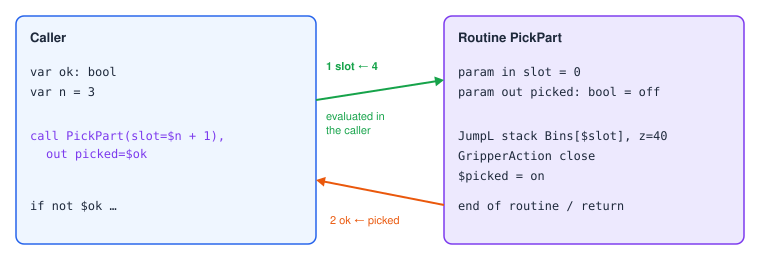

# Routines and Parameters

A **routine** is a program that other programs call. Use routines for anything you do in more than
one place — picking a part, changing a tool, a homing check — so it is written and fixed once.

## Making a routine

Set the program's kind to **Routine** in Program Settings (in a file: `@program {"isRoutine": true}`).
A routine is hidden from the program list and runs only when called.

## Parameters

A routine's variables can be **parameters**:

| Mode | Text | Direction |
|---|---|---|
| in | `param in slot = 0` | The caller passes a value in. |
| out | `param out picked: bool = off` | The routine passes a value back. |
| in-out | `param inout tally = 0` | Both. |

```srs
#!srs 1
@program {"name": "PickPart", "isRoutine": true}
param in slot = 0
param out picked: bool = off

MoveJ Approach
JumpL stack Bins[$slot], z=40, speed=150
GripperAction close
Wait 200ms
MoveL here, offset=(z=30), speed=100
$picked = true
```

## Calling

```srs
call PickPart                                   # no arguments
call PickPart(slot=$i)                          # in arguments
call PickPart(slot=$i + 1), out picked=$ok      # and an output
```



1. Each `in` / `inout` argument is evaluated **in the caller's scope** before the routine's variables
   are set up — so `slot=$slot + 1` reads the caller's `$slot`. A text parameter takes a template; a
   list parameter takes a list variable (copied).
2. The routine runs.
3. When it ends — its last step or a `return` — each mapped `out` / `inout` parameter is copied into
   the caller's variable (created if not declared). An `in` parameter is never copied back.

A parameter with no argument keeps its declared value (validator warning `paramMissing`).

## Rules

- Routine variables live in the **same variable scope** as the caller's, so give parameters names
  that do not clash with the caller's variables.
- A routine is a boundary: `goto` and `break` / `continue` inside it never reach the caller's labels
  or loops.
- A routine that does not finish (it fails, or a Try abandons it) copies no outputs.
- A routine must not call itself, directly or through others (`routineRecursion`).
- An error inside a routine travels out to the caller's Try, like any other error — see
  [Error Handling](#errors).
