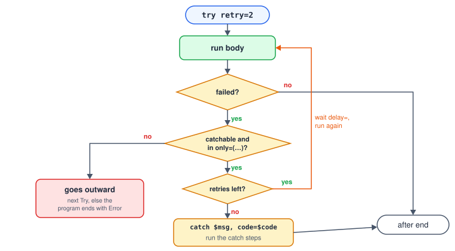
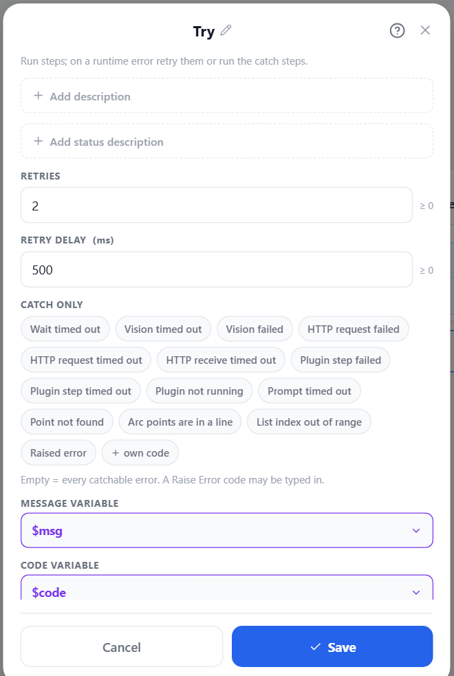
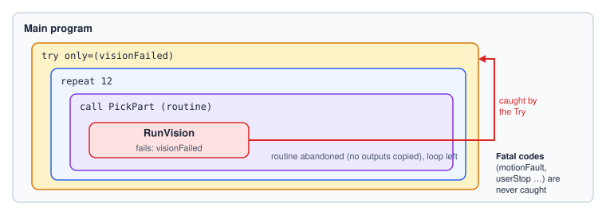

# Error Handling

Problems reach you at two moments:

| When | What | Effect |
|---|---|---|
| **Before the run** | Parse problems (text) and validation problems (both views) — unknown names, misspelt variables, missing fields. | Errors block **running** (and parse errors block saving in Text view); warnings do not. See [Running and Debugging](#running). |
| **During the run** | A step **fails** with an error code — a wait timed out, a vision result did not come, an HTTP server did not answer. | The program ends with **Error** — unless a Try catches the code. |

## Catchable and fatal codes

Every runtime failure has a code. Codes are either **catchable** — runtime conditions a program can
reasonably recover from — or **fatal** — hardware, safety or authoring problems a Try must never
hide.

| Catchable | Fatal (never caught) |
|---|---|
| `waitTimeout` `visionTimeout` `visionFailed` `httpFailed` `httpTimeout` `receiveTimeout` `pluginFailed` `pluginTimeout` `pluginNotRunning` `promptTimeout` `pointNotFound` `arcDegenerate` `indexOutOfRange` `userError` — and any code you raise yourself | `motionFault` `jointLimit` `driverDisconnected` `emergencyStop` `userStop` `unknownVariable` `expressionSyntax` `computedVariable` `badListOperation` |

The full table, with what raises each code, is in [Error and Problem Codes](#error-codes).

## Try, retry and catch



```srs
var msg: string
var code: string
try retry=2, delay=500ms
  RunVision Detect_Parts, pass=$ok
  if not $ok
    raise "No parts found", code=noParts
  end
catch $msg, code=$code, only=(visionTimeout, noParts)
  status error "Vision failed: {$msg} ({$code})"
  exit
end
```

When a step inside the body fails with a catchable code — at any depth, inside loops, branches and
called routines:

1. everything inside the Try is abandoned (a routine that did not finish copies no outputs);
2. while retries are left, the body runs again from the top after `delay=`;
3. then the message and code go into the catch variables and the **catch** steps run. An empty catch
   simply ignores the error. Either way the program carries on after `end`.

| Argument | Meaning |
|---|---|
| `retry=` | How many times to run the body again (default 0). |
| `delay=` | Wait between attempts (`500ms`, `2s`). |
| `catch $msg` | Text variable for the error message (created if not declared). |
| `code=$code` | Text variable for the error code. |
| `only=(a, b, …)` | Catch only these codes; others go to the next enclosing Try. Empty = every catchable code. |

Each catch is logged, e.g. `[Caught waitTimeout] … — retry 1 of 2`. A failure inside the catch steps
goes outward too.



## How an error travels



When the program ends with Error, its status carries the message and the `errorCode`, and the monitor
shows the step that failed.

## Raising your own errors

[Raise Error](#ref-RaiseError) fails on purpose with your message and an identifier of your choice:

```srs
if $grams < 5
  raise "Slot {$i} is empty", code=emptySlot
end
```

A code of your own is always catchable, so an enclosing `try … only=(emptySlot)` can handle exactly
this case. The default code is `userError`. Raising a fatal code (e.g. `motionFault`) is a validator
warning — no Try could catch it.

## Waits that fail

A condition Wait only fails when you ask it to: with `onTimeout=error` it raises `waitTimeout`;
otherwise it continues and sets its timed-out flag. Choose per case:

```srs
Wait until $stb.in1, timeout=5s, timedOut=$late   # handle it inline
try retry=3
  Wait until $stb.in1, timeout=5s, onTimeout=error  # or let a Try retry it
catch
end
```

## Which steps fail with which code

| Step | Catchable failure |
|---|---|
| Wait (condition, `onTimeout=error`) | `waitTimeout` |
| Run Vision | `visionTimeout` (no result in time), `visionFailed` (processor lost, robot frame not available) |
| Capture Image / Save Image | `visionFailed` (no camera frame) |
| HTTP Request (waiting for the reply) | `httpFailed` (network error, non-2xx status), `httpTimeout` |
| HTTP Receive | `receiveTimeout` |
| Plugin step, plugin functions | `pluginFailed`, `pluginTimeout`, `pluginNotRunning` |
| Moves with a template or list target | `pointNotFound` |
| Move Arc | `arcDegenerate`, `pointNotFound` |
| List, Save Position | `indexOutOfRange` |
| Prompt (timeout without a timeout button) | `promptTimeout` |
| Raise Error | `userError` or your own code |
