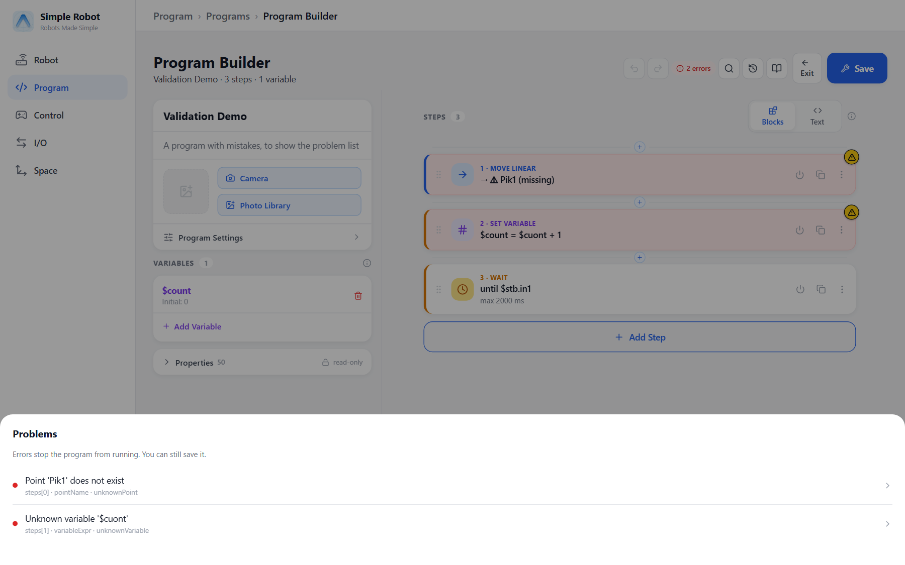
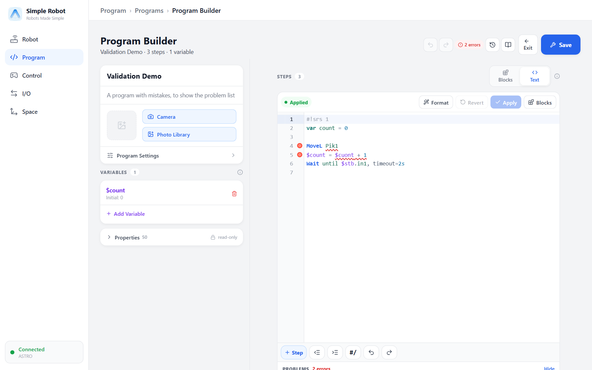
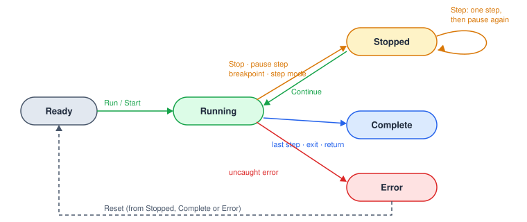
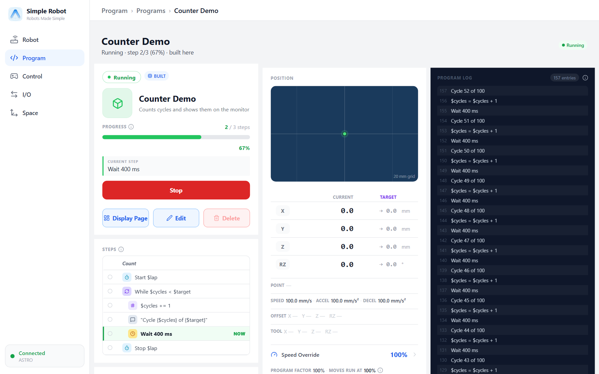
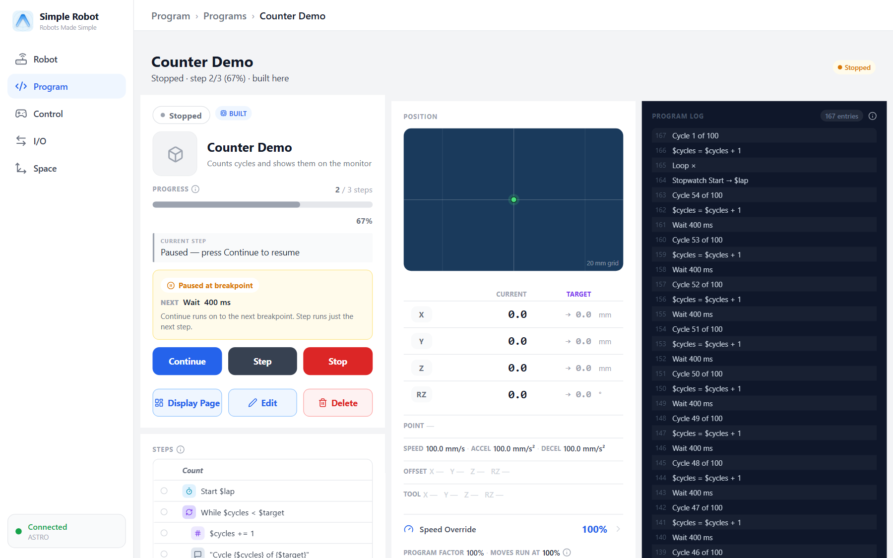

# Running and Debugging

## Checking a program before it runs

The controller checks a program every time it changes. The problem count appears in the editor
header; tap it to see the list. Each problem names its step (and field), and tapping it jumps there.

- **Errors** block running: an unknown variable, an expression that does not parse, a missing
  required field, a reference to something that does not exist, a loop or branch with no steps.
- **Warnings** do not: an unknown point you have not taught yet, an unused variable, a disabled step,
  a step after an endless loop.

In Text view the same problems are underlined on their lines, together with parse problems such as a
missing `end`.

The codes are listed in [Error and Problem Codes](#error-codes).

## Program states

| State | Meaning |
|---|---|
| Ready | Not running; the next start begins at the top. |
| Running | Executing steps. |
| Stopped | Paused with its place kept — by the operator's Stop, a Pause Program step, a breakpoint or step mode. A move that was interrupted resumes on Continue. |
| Complete | Finished normally: after the last step, an `exit`, or a `return` in the main program. |
| Error | Ended by an uncaught error; the status carries the message and `errorCode`, and the failed step is marked. |

## The monitor

The monitor shows the running program: its status text (from [Status Update](#ref-StatusUpdate)),
the current step, the variables marked **monitor**, display images, the run controls (start, stop,
and while paused Continue and Step) and the operator speed override.

Program moves are scaled by the speed override; manual jogging is not. The run log (per program)
records each step, skipped steps, caught errors and status messages.

## Breakpoints

Set a breakpoint on a step in the editor (in Text view: in the gutter). The program pauses
**before** that step, with pause reason *breakpoint*; Continue runs on. A breakpoint inside a loop
pauses on every pass. Breakpoints are kept per program in the app and can be changed while the
program runs.

## Step mode

In step mode the program pauses before **every** step (pause reason *step*). **Step** runs the paused
step and pauses before the next; **Continue** leaves step mode and runs on. Notes and disabled steps
never pause, and a step that takes time (a Wait, the legs of a Jump, a vision run) is never paused
half-way.

## Run from step

Run from step starts the program at a chosen step:

- enclosing loops start at their first pass (count 0, for-each element 0; a while condition is not
  checked), and enclosing branches, Try bodies or catches are entered without evaluating anything;
- the steps before it do not run, so variables start at their declared values;
- a step inside a routine, a disabled step or a step inside a CNC block cannot be a starting point.

Background programs ignore breakpoints, step mode and run from step; a plain start clears them.

## Debugging tips

- Put `status "…{$var}…"` steps at interesting places — the message appears on the monitor and in
  the log.
- Mark variables **monitor** to watch them live.
- Use `SetSpeedFactor 25` at the top while proving out a new program, and remove it after.
- Disable (`@off`) a section instead of deleting it while you test the rest.
- Test a formula with the expression tester before running it.
