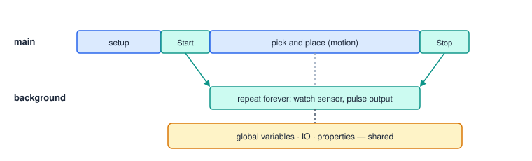

# Background Programs

A **background program** runs in parallel with the main program — watching a sensor, pulsing a
conveyor, logging values, talking to another machine — while the main program moves the robot.



## Making and starting one

Set the program's kind to **Background** in Program Settings (in a file:
`@program {"isBackground": true}`). Start, stop and wait for it from another program:

```srs
StartBackground Conveyor_Watch        # starts it and continues at once
…
StopBackground Conveyor_Watch         # stops it
WaitForBackground Conveyor_Watch      # or: wait until it finishes by itself
```

A background program that ends itself (`exit`, `return`, its last step) ends only itself.

## What runs in the background

Background programs **skip** the steps that would fight the main program for the robot. In the
[Instruction Reference](#instructions) each entry says whether the step runs in background programs.

| Skipped in background | Runs in background |
|---|---|
| Move Linear, Move Joint, Jumps, Move Arc, Thread Move, Run Homing | Waits, variables, lists, flow control, Try |
| Set Speed (Linear / Joint), Set Speed Factor | Outputs, load cells, recordings, export |
| Set Tool, Set Local, Clear Local | Aux axes, gripper, conveyor, rotary |
| | Vision, HTTP, status, prompts, plugin steps |

Breakpoints, step mode and run from step do not apply to background programs.

## Sharing data

Each program run has its own variables. To share values between the main program and a background
program, declare them **global** in both:

```srs
global var conveyorRuns = 0
```

IO and properties are shared by nature. A background program can also show a Prompt (one at a time
per program).

## Example

```srs
#!srs 1
@program {"name": "Conveyor Watch", "isBackground": true}
global var conveyorRuns = 0

repeat forever
  Wait until $stb.in1 == 0, timeout=10s
  SetOutput stb 2 on, pulse=500ms, blocking=on
  $conveyorRuns = $conveyorRuns + 1
  Wait 1s
end
```

> **Caution** A background program that writes a saved point (Save Position) changes it for every
> program; the validator warns (`pointWriteInBackground`).
