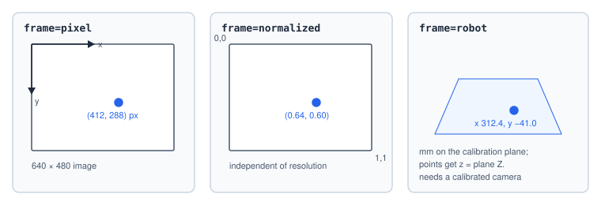

# Vision

A **vision program** is a list of small tools that run on a camera image: locate something, inspect
it, and output numbers. The [Run Vision](#ref-RunVision) step runs one and copies its results into
program variables.

## Vision programs

Vision programs are built under **Program → Vision**. They follow the pattern used by commercial
vision software — **locate → inspect → output**:

| Tool family | Tools | Outputs |
|---|---|---|
| Locate | find line, find corner, find circle, blob, contour match, pattern match, ArUco marker, make fixture | a **pose** (`x`, `y`, `angle`), points, lines, items |
| Measure | caliper, distance, angle, corners, lines | distances, angles, points |
| Presence / count | pixel count, intensity, edge pixels, polygon — each can be split into a **grid** of cells | a main value per cell (`percent`, `mean`, `density`, `count`) |
| Read | barcode / QR code | text `value`, `format` |

Any locating tool can be a **fixture** for later tools: their regions then move with the found part.
Each tool has **limits** on its values; a tool *passes* when it ran, found what it looks for and
meets its limits. The program passes when every tool that counts toward the pass passes.

## Run Vision

```srs
var ok: bool = off
var edgeAngle = 0
var cells: list record
var parts: list point
RunVision Detect_Parts, frame=robot, pass=$ok
  Top_edge.angle -> $edgeAngle        # a value of a tool
  Slots.cells -> $cells               # one record per grid cell
  Top_edge.points -> $parts           # a Points list
end
```

Each row is `tool.value -> $variable` — the tool by name (underscore form for names with spaces).
Variables named in rows are created if not declared.

| Value | Variable | Written |
|---|---|---|
| any key of the tool's values: `angle`, `count`, `percent`, `distance`, `radius`, `x`, `y` … | number (text for a barcode's `value`) | the value; `x` / `y` converted by `frame=` |
| `passed` | boolean | 1 when the tool's status is ok and every limit is met |
| `found` | boolean | the tool's `found` value |
| `status` | text | `ok`, `fail`, `notRun` or `error` |
| `cells` | Record list | per grid cell, row-major: `row`, `col`, `index`, `value`, `passed` |
| `items` | Record list | the tool's records (blobs, matches, markers, codes) |
| `points` | Point list | the tool's points |
| `lines` | Record list | `{x1, y1, x2, y2}` per line |
| `pose` | Record list | one record `{x, y, z, angle}` when found, else empty — read `$pose[0].x` |

## Coordinates



| `frame=` | Positions are |
|---|---|
| `pixel` (default) | pixels of the image, origin top-left, y down |
| `normalized` | 0–1 of the image width and height |
| `robot` | millimetres on the camera's calibration plane; points get `z` = the plane's Z. Needs a calibrated camera (`cameraNotCalibrated` otherwise); `$camera.<id>.calibrated` tells. |

Widths, radii and distances always stay in pixels. Angles are degrees, positive clockwise on screen.

## Using the results

```srs
if not $ok
  raise "Inspection failed", code=inspectFail
end
for _, $i in $cells
  if $cells[$i].passed == 0
    status warning "Cell {$cells[$i].row},{$cells[$i].col} is empty"
  end
end
for _, $i in $parts
  JumpL $parts[$i], z=40           # with frame=robot, points are robot positions
end
```

A tool that did not run (its fixture was not found) writes empty lists and 0 for `passed`, `found`
and `count`.

## Timing and failures

Run Vision waits for a fresh result — up to 30 s by default. It fails with `visionTimeout` when no
result comes in time and `visionFailed` when the vision processor is lost or the robot frame is not
available. Both are catchable:

```srs
try retry=2, delay=500ms
  RunVision Detect_Parts, pass=$ok
catch $msg
  status error "Camera problem: {$msg}"
end
```

## Images

```srs
var photo: image
CaptureImage $photo, camera=Top_Camera                 # into an image variable
SaveImage "shots/part-{$time_ms}.jpg", camera=Top_Camera   # straight to a file
```

An image variable can be sent with HTTP Request (`send "photo" = image $photo`), handed to a plugin,
exported, or shown on a display page. Both steps fail with `visionFailed` when the camera has no
frame.
