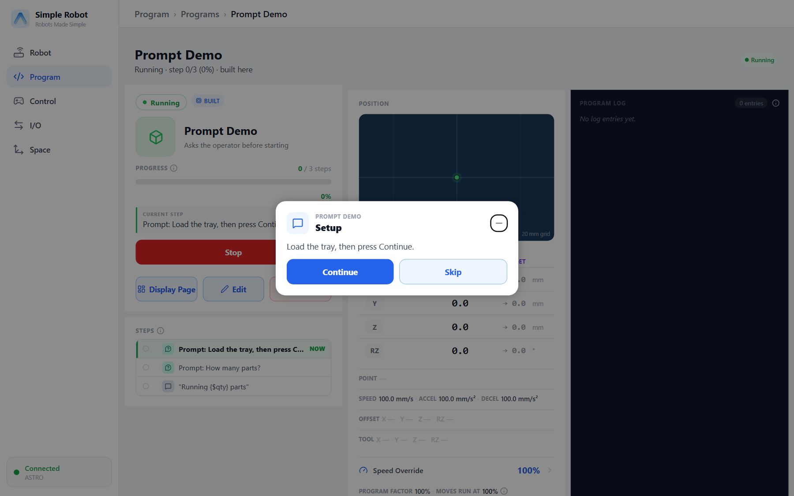
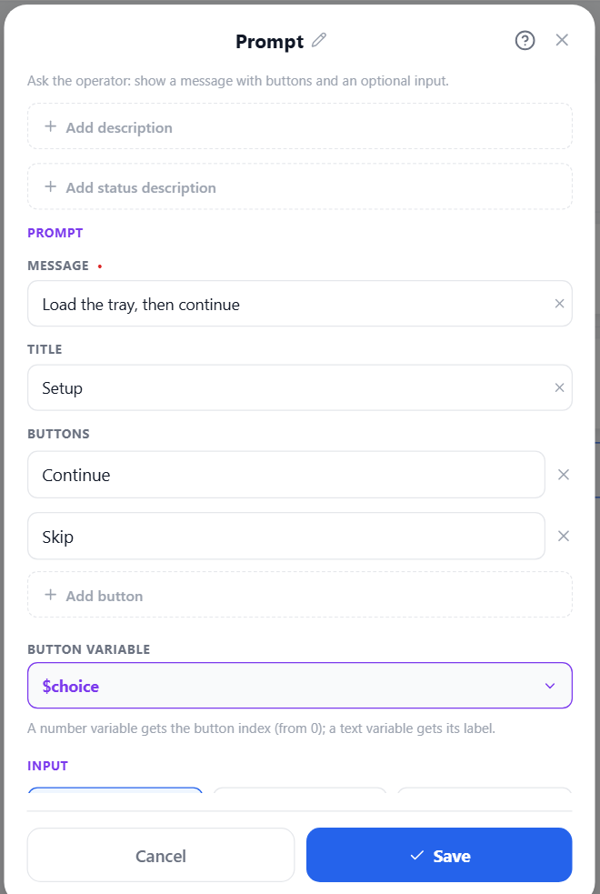

# Operator Prompts and Communication

## Status messages

[Status Update](#ref-StatusUpdate) publishes a line to the monitor and the run log. The text is a
template.

```srs
status "Placed {$count} parts"
status warning "Tray almost full"
status error "Vision failed: {$msg}"      # shown as an error — the program carries on
```

## Asking the operator

[Prompt](#ref-Prompt) shows a dialog with a message, 1–4 buttons and optionally a number or text
input, and waits for the answer. The dialog appears in the app on whatever screen the operator is on.

```srs
var choice = 0
var qty = 0
prompt "Load the tray, then press Continue.", title="Setup", buttons=("Continue", "Skip"), result=$choice
if $choice == 1
  exit "Skipped by operator"
end
prompt "How many parts?", input=number, default=10, min=1, max=50, value=$qty
```



| Argument | Meaning |
|---|---|
| message (position 1) | The text, a template. |
| `title=` | Optional title. |
| `buttons=(…)` | 1–4 labels (default `OK`). |
| `result=$v` | A number variable gets the button index (from 0); a text variable gets its label. |
| `input=number \| text` | Ask for a value; `default=`, and for numbers `min=` / `max=`. |
| `value=$v` | Receives the typed value. |
| `timeout=` | Give up after this long (0 = wait forever). |
| `onTimeout=<n>` | The button pressed on timeout. Without it a timeout fails with `promptTimeout`. |

The first answer wins (from any connected app). A **Stop** keeps the dialog on screen but refuses
answers; **Continue** shows it again with its timeout restarted.



For a simple "check this, then continue", [Pause Program](#ref-PauseProgram) after a status message
also works.

## HTTP

[HTTP Request](#ref-HttpRequest) POSTs JSON to another machine and can read values from the reply.

```srs
var count = 0
var next = 0
var photo: image
HttpRequest "http://192.168.4.10:8080/report", wait=on, timeout=5s
  send "count" = $count               # a number (any expression)
  send "photo" = image $photo         # an image, base64 JPEG
  receive "next" -> $next             # a key of the JSON reply
end
```

- Rows: `send "key" = expression`, `send "key" = list $var`, `send "key" = image $var`, and
  `receive "key" -> $var`.
- With `wait=on` (default) it fails `httpFailed` (network error, non-2xx status) or `httpTimeout` —
  both catchable. An empty or non-JSON reply is not a failure. With `wait=off` it never fails.

[HTTP Receive](#ref-HttpReceive) waits for another machine to POST JSON to the controller at
`/webhook/<name>`:

```srs
var x = 0
HttpReceive "orders", timeout=60s
  receive "x" -> $x
end
```

It fails `receiveTimeout` when nothing arrives in time.

## Exporting data

[Export Data](#ref-ExportData) writes values to a CSV or JSON file on the controller — one column
(or key) per row:

```srs
ExportData csv "logs/run-{$time_ms}.csv"
  "parts" = $count
  "weights" = list $weights
  "photo" = image $photo
end
```

The path is a template; a relative path is relative to the controller's folder, and missing folders
are created.
