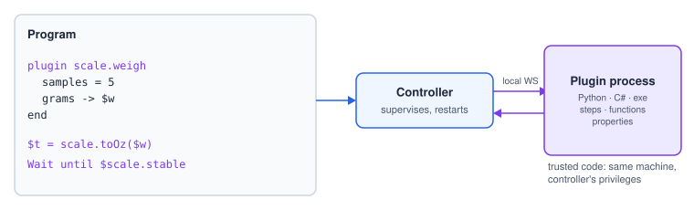

# Plugins

A **plugin** extends the controller with code of its own — a bench scale, a barcode reader, a PLC
gateway, a database logger. It runs as a separate process (Python, C# or any executable) that the
controller starts and supervises, and it can contribute three things to programs:



| Contribution | Used as | Example |
|---|---|---|
| **Steps** | blocks in the Plugins category; `plugin <id>.<step>` in text | `plugin scale.weigh` |
| **Functions** | in any expression | `scale.tare()`, `scale.toOz($g)` |
| **Properties** | live read-only values | `$scale.weight`, `$scale.stable` |

Plugins are installed and configured under **Program → Plugins**. They are trusted code: they run on
the same machine with the controller's privileges.

## Plugin steps

```srs
var w = 0
var history: list number
plugin scale.weigh, timeout=5s
  samples = $n * 2          # unquoted: an expression
  unit = "g"                # quoted: the exact text
  weights = history         # a list parameter: the list variable's name
  grams -> $w               # an output into a variable
end
```

- Parameter rows are typed by the plugin's manifest: numbers and booleans take expressions, text
  takes a template, an option is taken literally, a point takes a point name (or `$pts[$i]`, a grid
  or stack cell), a list or image takes a variable name.
- A missing parameter uses the manifest's default; a required one without a default stops the
  program.
- Output rows `key -> $var` write the plugin's results; an output the plugin does not return is
  skipped.
- While the step runs the monitor shows the plugin's progress. A Stop cancels the step; Continue
  sends it again.
- Plugin steps run in background programs too.

| Failure | Code (catchable) |
|---|---|
| The plugin is not running | `pluginNotRunning` |
| The plugin answered with an error | `pluginFailed` |
| No answer within the timeout | `pluginTimeout` |

## Plugin functions and properties

```srs
$t = scale.toOz($w)              # a function call
Wait until $scale.stable          # a live property
```

A function call blocks the program until the plugin answers (default limit 250 ms) — prefer a
**property** for anything read every tick, such as a wait or a stop condition. A property the plugin
has not set yet is unknown and stops the program like a misspelt variable.

The validator knows the installed plugins: an unknown plugin or step, a missing required parameter
or an output into the wrong kind of variable is reported before the run, and a plugin that is not
running is a warning.
