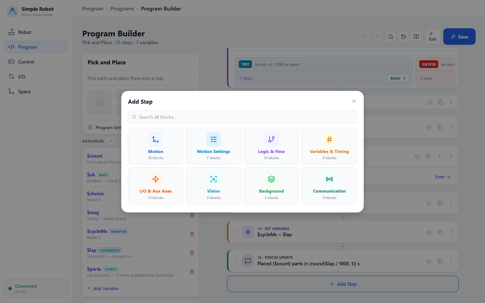

# Instruction Reference

This chapter has one entry per step type, grouped by the categories of the Blocks step picker. Every
entry has the same layout:

| Part | Contents |
|---|---|
| Heading | The step's name in Blocks, and its keyword in Simple Robot Script. |
| Summary line | What it does, its category, and whether it runs in background programs. |
| Syntax | The text form. `<…>` is a value you supply, `[…]` is optional, `a \| b` is a choice. |
| Parameters | Each field: where it goes in the text (*position n* = the n-th value after the keyword, `name=` = a named value), its type, unit and default. **fx** marks fields that also take an expression. |
| Description and notes | Behaviour and restrictions. |
| Errors | The runtime error codes the step can fail with; *catchable* ones can be handled with a Try. Expression errors (`unknownVariable`, `expressionSyntax`) apply to every field that takes an expression. |
| Example | The same example in Blocks (a screenshot) and in text. |
| See also | Related steps. |

The parameter tables, syntax lines, units and defaults are generated from the controller's step
catalog (`GetStepCatalog`).

